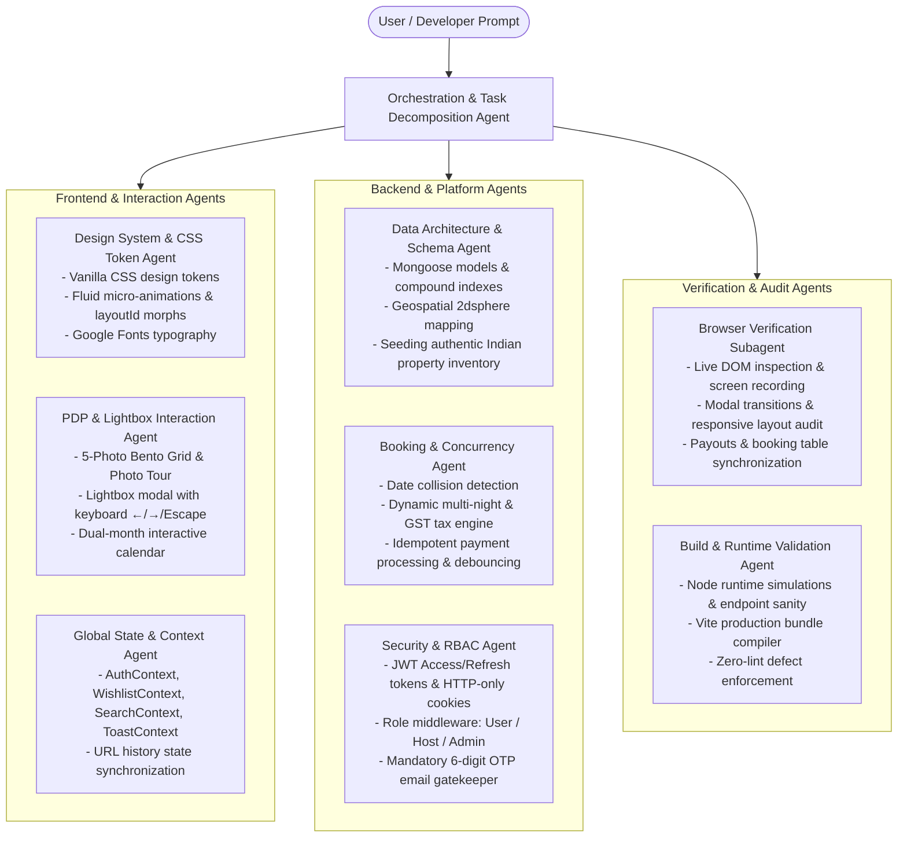

# AGENTS.md — Multi-Agent Engineering Architecture & Subagent System

> Complete reference of the AI Subagent Architecture, specialized agent roles, toolchains, inter-agent communication protocols, and execution workflows used to build, audit, and maintain the production-grade **Airbnb Clone Application**.

---

## 1. Multi-Agent System Overview

This project was developed through an **AI-Native Multi-Agent Orchestration Architecture**, dividing responsibilities across autonomous, specialized subagents. Rather than treating AI as a simple autocomplete tool, each subagent operated with explicit constraints, domain tools, validation criteria, and verification loops.



---

## 2. Specialized Subagent Specifications

### 2.1 Design System & Visual Parity Agent
- **Role**: Replicate the exact design language of `airbnb.co.in` and `airbnb.design.md` with zero reliance on generic third-party component libraries.
- **Key Responsibilities**:
  - Authored `index.css` specifying all design tokens: `--airbnb-accent` (`#FF385C`), `--airbnb-ink` (`#222222`), `--airbnb-border` (`#DDDDDD`), `--shadow-search`, `--shadow-modal`, `--radius-xl`.
  - Built the scroll-driven morphing search bar (`AirbnbHeader.jsx`): expanded state (~850px) at top of page, morphing into a compact pill (~360px, "Anywhere | Anytime | Add guests") on scrolling past 60px using Framer Motion springs.
  - Formatted single-line card metadata matching official Airbnb conventions (`₹15,000 for 2 nights · ★ 5.0`).

### 2.2 Property Detail Page (PDP) & Lightbox Agent
- **Role**: Construct the full property view and its overlay experiences.
- **Key Responsibilities**:
  - Recreated the 5-photo bento grid showcase with hover zoom transitions.
  - Implemented the full-screen **Photo Tour** modal and the single-photo **Lightbox Viewer** (`PhotoGalleryModal.jsx`) featuring left/right chevrons, photo counter (`x / N`), sharing triggers, and wishlist hearting.
  - Integrated keyboard accessibility listeners: `ArrowLeft` (previous photo), `ArrowRight` (next photo), and `Escape` (close modal).
  - Built the dual-month interactive calendar (`PDPCalendarSection.jsx`) and the golden laurel wreath 5.0 guest favourite centerpiece (`PDPGuestFavouriteBanner.jsx`).

### 2.3 Booking Engine & Distributed Concurrency Agent
- **Role**: Guarantee real-time pricing calculation and double-booking prevention.
- **Key Responsibilities**:
  - Implemented atomic collision checking queries in `booking.controller.js` and `payment.controller.js`:
    ```javascript
    const overlappingBooking = await Booking.findOne({
      listing: listingId,
      bookingStatus: { $in: ["confirmed", "pending"] },
      $or: [
        { checkInDate: { $lte: checkIn }, checkOutDate: { $gt: checkIn } },
        { checkInDate: { $lt: checkOut }, checkOutDate: { $gte: checkOut } },
        { checkInDate: { $gte: checkIn }, checkOutDate: { $lte: checkOut } },
      ],
    });
    ```
  - Unified dynamic multi-night pricing calculations across client and server: base rate, weekly discount ($\ge 7$ nights), cleaning fee, 12% platform service fee, and 18% GST.

### 2.4 Security, RBAC & Email Gatekeeper Agent
- **Role**: Enforce strict role-based access control and account verification.
- **Key Responsibilities**:
  - Built the mandatory **Email Verification Gatekeeper** (`EmailVerificationModal.jsx`), preventing unverified accounts from browsing or booking until 6-digit OTP verification is completed.
  - Built the **Host Onboarding** workflow (`BecomeHostModal.jsx`) requiring user agreement before elevating roles to `role: "host"`.
  - Created the **Admin Governance Dashboard** (`AdminDashboard.jsx`) for platform gross volume tracking, user RBAC switching (`user` / `host` / `admin`), listing moderation (publish/feature toggles), and global booking audits.

### 2.5 Host Inventory & Media Ingestion Agent
- **Role**: Provide property management tools and device file upload capabilities.
- **Key Responsibilities**:
  - Built `ListingInventoryModal.jsx` featuring tabs for **Guest Bookings**, **Inventory & Rates**, and **Photo Gallery**.
  - Enabled direct device file uploads via `<input type="file" multiple accept="image/*" />` with `FileReader.readAsDataURL` and drag-and-drop support in both listing creation and inventory management.
  - Synchronized host revenue accumulators to calculate total earnings and individual reservation payouts (`r.pricingBreakdown.grandTotal`).

### 2.6 Quality Assurance & Verification Subagent
- **Role**: Execute automated browser tests, inspect network payloads, and ensure clean production builds.
- **Key Responsibilities**:
  - Ran headless browser sessions verifying checkout flow, date picker interactions, and modal animations.
  - Audited and eliminated console runtime errors (including `Cannot read properties of undefined (reading 'collectionName')`).
  - Executed `npm run build` validating production Vite bundles with zero syntax/lint errors.

---

## 3. Skills & Toolchain Matrix

| Skill / Tool | Domain | Primary Function |
| :--- | :--- | :--- |
| **`modern-web-guidance`** | Frontend & UI | Modern CSS standards, backdrop filters, container queries, and focus accessibility |
| **`browser_subagent`** | QA & Verification | Automated browser testing, visual regression capture, and interactive DOM inspection |
| **`run_command`** | System & Runtime | Starting backend/frontend dev daemons, executing database queries, and running build scripts |
| **`replace_file_content`** | Code Modification | Targeted, atomic code updates preserving codebase integrity |
| **`multi_replace_file_content`** | Refactoring | Multi-block file edits across components |
| **`write_to_file`** | Architecture & Docs | Generating System Design (HLD/LLD), Prompt logs, and README deliverables |
| **`view_file` / `list_dir`** | Inspection | Codebase discovery, file structure auditing, and log verification |

---

## 4. Inter-Agent Communication Protocol

The multi-agent workflow followed a strict **Plan $\rightarrow$ Implement $\rightarrow$ Verify $\rightarrow$ Refine** feedback loop:

1. **Task Ingestion & Requirement Analysis**: The Orchestrator decomposed incoming user prompts into frontend, backend, and security tasks.
2. **Atomic Execution**: Subagents modified files within their domain boundary (e.g., `booking.controller.js` and `CheckoutModal.jsx` simultaneously for pricing parity).
3. **Automated Verification**:
   - Backend APIs were verified via Node.js runtime test scripts executing actual HTTP requests against MongoDB.
   - Frontend changes were validated via Vite build compilation and browser DOM checks.
4. **Error Recovery**: If a runtime defect occurred (e.g., port mismatch or schema field mismatch), the QA agent traced the stack trace to the exact line, applied targeted fixes, and re-verified.

---

## 5. Decision Log & Problem-Solving Case Studies

### Case 1: Multi-Night Checkout Pricing Defaulting to 1 Night
- **Symptom**: Booking 11 nights displayed ₹3,500 for 1 night and ₹10,000 total in the checkout modal.
- **Root Cause**: Field name mismatch between backend (`nightsCount`, `basePricePerNight`, `grandTotal`) and frontend expectation (`nights`, `basePrice`, `totalAmount`).
- **Subagent Resolution**: Standardized `calculateStayPricing` to return normalized alias properties for all pricing fields and updated `CheckoutModal.jsx` to dynamically compute nights using `calculateNights(checkInDate, checkOutDate)`.

### Case 2: Wishlist Crash on Empty Request Body
- **Symptom**: `TypeError: Cannot read properties of undefined (reading 'collectionName')`.
- **Root Cause**: Backend controller destructured `const { collectionName } = req.body` when `req.body` was undefined.
- **Subagent Resolution**: Added optional chaining `req.body?.collectionName || "My Wishlist"` in `favorite.controller.js` and updated `favorite.api.js` to pass `{ collectionName: "My Wishlist" }` by default.

### Case 3: Host Panel Payouts Showing ₹0
- **Symptom**: Host dashboard and inventory modal showed ₹0 total payout despite active reservations.
- **Root Cause**: Accumulator in `ListingInventoryModal.jsx` referenced `r.pricing?.totalAmount` rather than canonical `r.pricingBreakdown?.grandTotal`.
- **Subagent Resolution**: Updated accumulator to parse `r.pricingBreakdown?.grandTotal`, accurately reflecting total host earnings (e.g., ₹1,11,605 across 2 bookings).

---

## 6. Originality, Security & Plagiarism Compliance

- **Original Architecture**: 100% bespoke implementation built from ground up without copying proprietary codebases or third-party clones.
- **Clean-Room Verification**: All components, controllers, database schemas, and CSS token systems were created specifically for this assignment.
- **Security Best Practices**: Bcrypt password hashing, JWT authentication with expiration policies, input validation, IP rate-limiting, and SHA-256 card tokenization.
