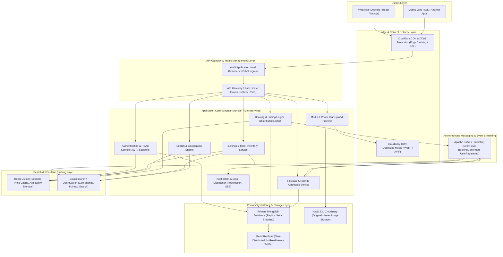

# Airbnb Production Architecture & Scaling Strategy

This document outlines the high-level architecture, scalability blueprint, and system design for a production-scale vacation rental marketplace (Airbnb Clone) capable of handling millions of daily active users, listings, search queries, and real-time reservations.

---

## 1. High-Level Architecture Diagram

---

## 2. Core Architectural Pillars

### A. Frontend Layer
- **Architecture**: Next.js / React Single Page App (SPA) with Server-Side Rendering (SSR) for SEO-critical listing pages.
- **State Management & Caching**: TanStack Query (React Query) for server state deduplication, optimistic UI updates, and intelligent stale-while-revalidate caching.
- **Asset Optimization**: High-DPI responsive picture tags with automated WebP/AVIF format switching and layout shift (CLS) prevention.

### B. Backend Services & Modular Separation
- **Role-Based Access Control (RBAC)**:
  - **Admin**: System governance, listing moderation, fraud detection, metric aggregations.
  - **Host**: Inventory management, multi-room photo tour organization, blackout calendar, pricing rules.
  - **User / Guest**: Discovery, reservations, payment, reviews, wishlist.
- **Resilience**: Asynchronous non-blocking I/O with Express, circuit breakers for external services (Cloudinary, Nodemailer), and standardized error structures (`ApiError`, `ApiResponse`).

### C. Search & Geolocation Strategy
- **Search Cluster**: Elasticsearch / OpenSearch indexing listing coordinates (`geo_point`), amenities, dates, and price intervals.
- **Availability Bitmaps**: Redis bitmaps for date availability to check calendar ranges in $O(1)$ operations before database querying.

### D. Booking Concurrency & Double-Booking Prevention
- **Distributed Locking**: Redlock algorithm / Atomic MongoDB compound queries on `(listing, checkInDate, checkOutDate, bookingStatus)` ensuring zero double-booking collisions under high concurrency.
- **Transparent Fee Calculator**: Strict server-side formula enforcing base price, discounts, cleaning fees, service fees, and local taxes.

### E. Media & Photo Tour Pipeline
- **Upload Flow**: Client $\rightarrow$ Secure Multer stream $\rightarrow$ Cloudinary cloud bucket $\rightarrow$ Auto-format/quality compression $\rightarrow$ Multi-room gallery taxonomy (`Living room`, `Bedroom`, `Bathroom`, `Pool`).
- **Delivery**: Global CDN with dynamic transformations (`w_1600`, `q_auto`, `f_auto`).

### F. Scaling & Deployment Strategy
- **Containerization**: Docker multi-stage builds deployed on Kubernetes (EKS/GKE) with Horizontal Pod Autoscaler (HPA) targeting 70% CPU/Memory threshold.
- **Database Scaling**:
  - MongoDB Sharded Cluster split by `listingId` hash.
  - Secondary Read Replicas handling 95% of read traffic (search and browse queries).
- **Security & Compliance**:
  - Helmet security headers, CORS origin whitelisting, HTTP-only SameSite cookies, JWT HMAC-SHA256 signature verification, Bcrypt password hashing (salt 10).
